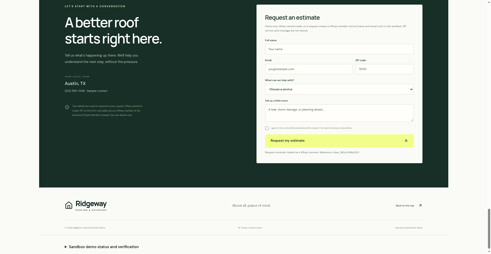
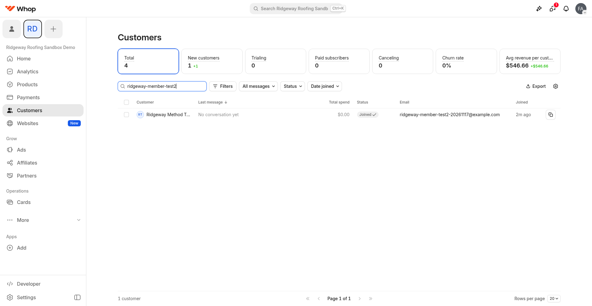

# Ridgeway Roofing - Whop website template

A responsive roofing company website built with React, TypeScript, Vite and Hono, made to be hosted as a Whop website app. The business is fictional. Payments run against the **Whop sandbox**. No real payments are taken. The deployed estimate form uses a separate, member-manage-only key to create a $0 customer in the live Ridgeway Roofing business.



## Features

- Responsive desktop and mobile design. Company name, service area, services, prices and copy live in `src/config.ts`.
- Three services: $149 inspection, $500 project deposit, $349 roof tune-up.
- Whop `CheckoutElement` and `ExpressCheckoutElement` for payment, with Whop-hosted card fields (no custom card inputs).
- Optional card-on-file step using `PaymentElement` and `BrandingElement`. Success is confirmed by a server read of the setup intent, not by HTTP 200.
- **Request-an-estimate form** that creates a customer record with Whop's **Create Member** API (`POST /api/v1/members`). It has input validation, contact consent, same-origin checks and a basic per-instance rate limit.
- Whop pixel events: `service_viewed`, `deposit_started`, and `estimate_requested` (fired only after a member ID comes back).
- Owner-only sandbox invoice script. There is no public invoice or charge endpoint.
- Server unit tests (network mocked).



## Note: Whop Leads is retired

This project originally sent estimate requests to the Whop Leads API. Whop has retired that API, so the form now uses Create Member instead. The key used for this needs only the `member:manage` permission. The unit test for the form mocks the network, so it does not prove a live call works. A live sandbox submit was checked separately and returned a `mber_` ID.

## Payment sandbox and live member capture

- Optional `WHOP_MEMBER_ENVIRONMENT=production`, `WHOP_MEMBER_ACCOUNT_ID` and encrypted `WHOP_MEMBER_API_KEY` route only Create Member to the live business. The key needs only `member:manage`. These variables do not switch payments to production.
- `WHOP_ENVIRONMENT` defaults to `sandbox`. Use a sandbox business and a sandbox API key together. Never mix production IDs with sandbox keys.
- Sandbox payments use test cards only. Apple Pay and Google Pay cannot run in the Whop sandbox, and this project does not fake them.
- The sample contact details are reserved example data. Replace them before any real launch. Add real privacy, contract, refund and scheduling terms, and verified licensing and insurance claims, before accepting real customers.

## Setup

Requires Node 22 or later.

```sh
npm ci
cp .env.example .env.local   # then fill in your sandbox values
npm run dev                  # preview with the Cloudflare Vite plugin
npm run typecheck
npm run build
node --test tests/server.test.mjs
node scripts/local-server.mjs   # serves the build + API on localhost:4173
```

Configuration (`.env.example`):

| Variable | Purpose |
| --- | --- |
| `WHOP_ENVIRONMENT` | `sandbox` (default) |
| `WHOP_SANDBOX_ACCOUNT_ID` | Sandbox business ID (`biz_...`) |
| `WHOP_SANDBOX_API_KEY` | Sandbox API key. Keep it as an encrypted Whop app secret. Never put it in a `VITE_` variable or commit it |
| `WHOP_INSPECTION_PLAN_ID`, `WHOP_DEPOSIT_PLAN_ID`, `WHOP_TUNEUP_PLAN_ID` | Plan IDs from provisioning |

Provision the three sandbox plans with `scripts/provision.mjs`. It is sandbox-only, reuses matching resources, and writes `catalog.sandbox.json` (IDs only, no secrets).

## Deploy

1. Authenticate the Whop CLI and link the app (`whop.app.json`).
2. Set the variables above as encrypted app secrets.
3. `npm run deploy` (runs `whop apps deploy`).

## Final-balance invoices (sandbox)

Create a local `job.json` with `jobId`, `accountId`, `memberId`, `depositPaymentId`, integer `totalCents`, `depositCents` and `workApproved`, then:

```sh
node scripts/invoice.mjs job.json draft
node scripts/invoice.mjs job.json issue-manual
```

The script checks the deposit payment (paid, same member and business, currency, not refunded) before it computes the balance. Drafts are the default and no email is sent.

## Project layout

```
src/         React app (main.tsx), Hono server (server.ts), config, tracking, styles
tests/       server unit tests
scripts/     provisioning, invoice, local server, visual check
public/      images
docs/        screenshots
```

## Credits and license

Code is MIT licensed (see `LICENSE`). Hero photo from Unsplash. Fonts: DM Sans and Manrope. Icons: Lucide. Third-party packages and media keep their own licenses.
